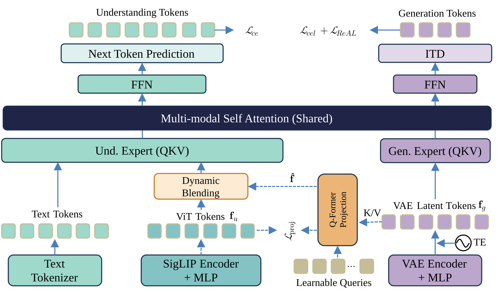
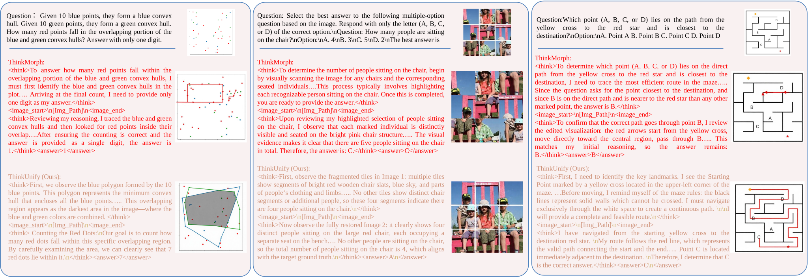

# ThinkUnify

**A Unified Multimodal Framework for Multi-Round Interleaved Visual Reasoning with Efficient Distillation**

> ThinkUnify is a unified vision-language model that bridges image generation and understanding within a single Mixture-of-Transformers (MoT) backbone, enabling coherent multi-round interleaved visual reasoning and high-quality image synthesis.

---

## Highlights

- **Q-Proj**: A Q-Former-based projection module that aligns VAE latent features with the SigLIP understanding space, eliminating the decode-re-encode bottleneck in multi-round reasoning.
- **ITD (Incremental Timestep Distillation)**: Compresses 50-step ODE solving into ~8 steps via online self-distillation, enabling interactive-speed generation within the unified 7B backbone.
- **ReAL (Reconstruction Alignment Loss)**: Enforces spatial-gradient and spectral-magnitude fidelity on predicted VAE latents, improving both generation quality and downstream reasoning.
- **123K Interleaved Dataset**: A synthetically constructed dataset covering 7 task categories for multi-step reasoning SFT.

---

## Architecture

<p align="center">
  
</p>

The MoT backbone processes a packed sequence of text, ViT understanding tokens, and VAE generation tokens. All tokens share multi-head self-attention layers while routing through modality-specific feed-forward experts.

- **Q-Proj** bridges the generation and understanding pathways by projecting VAE latents into the SigLIP feature space.
- **ITD** accelerates denoising by teaching the model shortcut velocities that span multiple Euler steps.
- **ReAL** enforces spatial-gradient and spectral-magnitude fidelity on the predicted clean latent.

---

## Release Roadmap

- [x] Training and evaluation scripts
- [x] Data processing / layout instructions (see [Data Download](#data-download))
- [ ] Training data release (coming soon)
- [ ] Model weights (coming soon)

## Main Results

### General Multimodal Understanding

| Model | AI2D | ChartQA | MathVista | MMMU | MMStar | RealWorldQA | VStar | Overall |
|-------|------|---------|-----------|------|--------|-------------|-------|---------|
| BAGEL-7B | 74.6 | 79.1 | 54.8 | 49.9 | 49.1 | 50.1 | 55.5 | 59.0 |
| **ThinkUnify** | **77.5** | **81.0** | **67.1** | **50.0** | **60.3** | **62.6** | **63.9** | **65.5** |

### Text-to-Image Generation (GenEval)

| Model | Single | Two | Counting | Colors | Position | Color Attr. | Overall |
|-------|--------|-----|----------|--------|----------|-------------|---------|
| BAGEL | 100 | 96 | 76 | 86 | 52 | 68 | 81 |
| **ThinkUnify** | 99 | 95 | **91** | **88** | **60** | **75** | **85** |

### Interleaved Reasoning (MIRA / UniMMMU / RealUnify)

| Model | MIRA | UniMMMU Avg | RealUnify Avg | Overall |
|-------|------|-------------|---------------|---------|
| BAGEL-7B | 8.8 | 22.8 | 33.3 | 21.6 |
| **ThinkUnify (Ours)** | **13.6** | **35.0** | **34.8** | **27.8** |

---

## Qualitative Results

<p align="center">
  
</p>

Multi-round interleaved generation and understanding. ThinkUnify maintains image quality and reasoning consistency throughout multiple dialogue rounds.

---

## Table of Contents

1. [Environment Setup](#environment-setup)
2. [Model Download](#model-download)
3. [Data Download](#data-download)
4. [Training](#training)
5. [Evaluation](#evaluation)
6. [Project Structure](#project-structure)
7. [Roadmap](#release-roadmap)
8. [Citation](#citation)
9. [License](#license)

---

## Environment Setup

ThinkUnify uses **two separate environments**: one for training and one for the evaluation harness (which vendors VLMEvalKit with extra dependencies). You may also use a single environment if you install the union of the requirements.

### 1. Training environment

```bash
conda create -n thinkunify python=3.10 -y
conda activate thinkunify

# Install PyTorch 2.5.1 matching your CUDA toolkit (example: CUDA 12.1)
pip install torch==2.5.1 torchvision==0.20.1 --index-url https://download.pytorch.org/whl/cu121

# Core dependencies
pip install -r requirements.txt

# FlashAttention 2 (required by the ViT/LLM backbone; build may take a while)
pip install flash-attn==2.5.8 --no-build-isolation
```

> **Note:** `requirements.txt` pins `transformers==4.49.0`, `numpy==1.24.4`, `pyarrow==11.0.0`, `safetensors==0.4.5`, etc. FlashAttention is commented out in the requirements file because its build depends on your CUDA/torch; install it separately as shown above.

### 2. Evaluation environment

The evaluation harness (`image_text_agent/`) wraps a vendored copy of VLMEvalKit.

```bash
conda create -n thinkunify_eval python=3.10 -y
conda activate thinkunify_eval

pip install torch==2.5.1 torchvision==0.20.1 --index-url https://download.pytorch.org/whl/cu121
pip install flash-attn==2.5.8 --no-build-isolation

# Agent + VLMEvalKit requirements
pip install -r image_text_agent/requirements.txt
pip install -r image_text_agent/evaluation/VLMEvalKit_Thinkmorph/requirements.txt
```

---

## Basic Model Download

ThinkUnify is built on top of **BAGEL-7B-MoT** checkpoint. No weights are bundled in this repository — download them yourself and point the code at them via environment variables.

```bash
# BAGEL-7B-MoT base (provides llm_config.json, vit_config.json, ae.safetensors)
huggingface-cli download ByteDance-Seed/BAGEL-7B-MoT --local-dir ./checkpoints/BAGEL-7B-MoT

```

Then export the base-config path used by both training and evaluation code:

```bash
export BAGEL_CONFIG_PATH=/abs/path/to/checkpoints/BAGEL-7B-MoT
```

| Env var | Used by | Meaning |
|---------|---------|---------|
| `BAGEL_CONFIG_PATH` | eval inference demo | Dir with `llm_config.json`, `vit_config.json`, `ae.safetensors` |
| `MODEL_PATH` | train / eval / demo | Base weights (train) or trained checkpoint dir (eval/demo) |
| `RESUME_FROM` | train | Checkpoint to resume / finetune from |

---

## Data Download

No datasets are bundled. The code reads data from external paths that you configure.

### Training data

Training reads **parquet** datasets registered in [`data/dataset_info.py`](data/dataset_info.py). Each registered dataset maps to a `data_dir` (holding `chunk_*.parquet` shards) and a `parquet_info_path` (a `*_parquet_summary.json`). The shipped file contains example absolute paths — **edit `data/dataset_info.py`** so each `data_dir` / `parquet_info_path` points at where you stored the corresponding parquet dataset (or symlink your data into one directory, see below).

Which datasets are actually loaded is controlled by the YAML config in [`data/configs/`](data/configs/). The default training config is [`data/configs/three_benchmark_v1_123k.yaml`](data/configs/three_benchmark_v1_123k.yaml) — the **123K interleaved-reasoning SFT set** — which selects dataset groups (`inter_reason`, `unified_edit`), their member `dataset_names`, `num_used_data`, and sampling `weight`. Change `DATA_YAML` to switch configs.

```yaml
# data/configs/<name>.yaml
dataset_group:
  dataset_names: [datasetA, datasetB]   # must be registered in data/dataset_info.py
  num_used_data: [countA, countB]
  weight: 1
  image_transform_args: {max_image_size: 768, min_image_size: 512}
```

> **Tip — collect one config's datasets in a single folder.** Only the datasets *named in your chosen YAML* are needed (commented-out entries are ignored). You can gather exactly those into one directory by name, e.g. symlinking each `data_dir` from `data/dataset_info.py`:
>
> ```bash
> mkdir -p /path/to/ThinkUnify_train_dataset
> # for every dataset_name listed in data/configs/three_benchmark_v1_123k.yaml,
> # link its data_dir (from data/dataset_info.py) into the folder under its own name:
> ln -s <data_dir_of_dataset> /path/to/ThinkUnify_train_dataset/<dataset_name>
> ```
>
> Then point the `data_dir` / `parquet_info_path` entries in `data/dataset_info.py` at `/path/to/ThinkUnify_train_dataset/<dataset_name>`.

### Evaluation data

The open-sourced evaluation covers **three benchmarks: MIRA, GenEval, and MathVista**.

- **MIRA** (interleaved reasoning) reads a JSONL file under `EVAL_DATA_ROOT`:

  ```bash
  export EVAL_DATA_ROOT=/abs/path/to/ThinkUnify_eval
  # expected: $EVAL_DATA_ROOT/MIRA/processed_data.jsonl
  ```

- **MathVista** and **GenEval** are **prepared on first run** from HuggingFace datasets and cached under `GENERAL_BENCH_CACHE_ROOT` (defaults to `$EVAL_DATA_ROOT/general_benchmark_cache`). Ensure the machine has network access to HuggingFace, or override:

  ```bash
  export GENERAL_BENCH_CACHE_ROOT=/abs/path/to/general_benchmark_cache
  ```

> **GenEval scoring** optionally uses the official Mask2Former pipeline (set `GENEVAL_PYTHON` to a python env with `mmdet`/`mmcv`/`open_clip`/`clip_benchmark`) and falls back to a vendored CLIP ViT-B/32 proxy otherwise. See [`image_text_agent/evaluation/all_benchmark/calculate_score/geneval.py`](image_text_agent/evaluation/all_benchmark/calculate_score/geneval.py).

---

## Training

The main training entry is [`scripts/thinkunify_train_srun.sh`](scripts/thinkunify_train_srun.sh). It launches FSDP distributed training of the MoT backbone with Q-Proj distillation, ReAL, and ITD (SCFM) enabled by default.

```bash
# Single node, 8 GPUs
export ENV_PATH=/abs/path/to/conda/envs/thinkunify      # your training conda env
export MODEL_PATH=/abs/path/to/checkpoints/BAGEL-7B-MoT
export RESUME_FROM=/abs/path/to/checkpoints/BAGEL-7B-MoT
export GPU_PER_NODE=8
export NNODES=1
export DATA_YAML=three_benchmark_v1_123k             # a config in data/configs/

bash scripts/thinkunify_train_srun.sh
```

### Key environment overrides

| Variable | Default | Meaning |
|----------|---------|---------|
| `ENV_PATH` | `YOUR_CONDA_ENV_PATH` | Conda env to activate |
| `MODEL_PATH` | `YOUR_BAGEL_7B_MOT_PATH` | Base BAGEL-7B-MoT weights |
| `RESUME_FROM` | `YOUR_RESUME_CKPT_PATH` | Checkpoint to resume / finetune from |
| `DATA_YAML` | `three_benchmark_v1_123k` | Dataset config name (without `.yaml`) |
| `OUTPUT_PATH` / `LOG_PATH` | `<repo>/OUTPUT/<exp>_<ts>` | Checkpoint / log output dirs |
| `GPU_PER_NODE` / `NNODES` / `RANK` / `MASTER_ADDR` / `MASTER_PORT` | 8 / 1 / 0 / 127.0.0.1 / 29500 | Distributed launch |
| `ENABLE_QFORMER_DISTILL` | `True` | Enable Q-Proj (Q-Former) VAE→understanding distillation |
| `QFORMER_VERSION` | `v2` | `v2` or SigLIP-aligned `v3` |
| `QFORMER_NUM_CA_BLOCKS` / `QFORMER_NUM_SA_BLOCKS` | 4 / 8 | Q-Former v3 block counts |
| `ENABLE_RECON_ALIGNMENT` | `True` | ReAL reconstruction-alignment loss |
| `ENABLE_SCFM` | `True` | ITD / shortcut flow-matching distillation |
| `SCFM_T_SKIP` / `SCFM_LORA_RANK` / `SCFM_LORA_ALPHA` | 2 / 64 / 128 | ITD hyper-parameters |

### Multi-node

Set `NNODES`, `RANK`, `MASTER_ADDR`, `MASTER_PORT` per node and launch the script on each node (it uses `torch.distributed.run` with `FULL_SHARD` FSDP).

Checkpoints are written to `$OUTPUT_PATH/ckpt/`, and W&B runs offline by default (`WANDB_MODE=offline`) under `$LOG_PATH/wandb`.

---

## Evaluation

The evaluation entry is [`scripts/thinkunify_eval_srun.sh`](scripts/thinkunify_eval_srun.sh). It runs `image_text_agent/evaluation/all_benchmark/run_bagel.py` through the vendored VLMEvalKit.

```bash
export MODEL_PATH=/abs/path/to/OUTPUT/<exp>/ckpt/0010000   # trained checkpoint dir
export BAGEL_CONFIG_PATH=/abs/path/to/checkpoints/BAGEL-7B-MoT
export EVAL_DATA_ROOT=/abs/path/to/ThinkUnify_eval
export PYTHON_EXE=/abs/path/to/conda/envs/thinkunify_eval/bin/python
export GPUS=8

# Tasks are passed as args (default: "MIRA GenEval MathVista")
bash scripts/thinkunify_eval_srun.sh MIRA GenEval MathVista
```

Supported tasks: `MIRA`, `GenEval`, `MathVista`.

### Relevant env vars

| Variable | Meaning |
|----------|---------|
| `MODEL_PATH` | Trained checkpoint directory (`.../ckpt/<step>`) |
| `BAGEL_CONFIG_PATH` | Base BAGEL config dir |
| `EVAL_DATA_ROOT` / `GENERAL_BENCH_CACHE_ROOT` | Eval data roots (see [Data Download](#data-download)) |
| `PYTHON_EXE` | Python interpreter of the eval env |
| `GPUS` / `NODES` | GPUs per node / node count |
| `NUM_TIMESTEPS` | Euler ODE steps for generation tasks (default 30) |
| `QFORMER_VERSION` / `QFORMER_NUM_CA_BLOCKS` / `QFORMER_NUM_SA_BLOCKS` | Must match the trained model |
| `ANCHOR_GEN` | Anchor-generation mode for interleaved tasks (default 1) |

Results and logs are written under `<repo>/RUN/<model_name>/`.

> **Optional LLM-as-judge.** MathVista scoring can use a GPT/Gemini judge. Provide your own credentials via environment variables (`AZURE_OPENAI_API_KEY`, `GEMINI_API_HOST`, `GEMINI_SECRET_ID`, `GEMINI_SECRET_KEY`, etc.). No credentials ship in this repo.

---

## Project Structure

```
ThinkUnify/
├── modeling/
│   ├── bagel/               # MoT model: bagel.py, qwen2_navit.py, siglip_navit.py,
│   │                        #   qformer.py / qformer_v3.py (Q-Proj), reconstruction_alignment.py
│   ├── qwen2/               # Qwen2 tokenizer / LLM
│   ├── siglip/              # SigLIP vision encoder
│   └── autoencoder.py       # VAE loader
├── data/
│   ├── dataset_base.py      # PackedDataset, token packing
│   ├── dataset_info.py      # DATASET_REGISTRY (edit data paths here)
│   ├── interleave_datasets/ # Interleaved reasoning / edit / T2I datasets
│   └── configs/             # YAML dataset configs (three_benchmark_v1_123k.yaml, ...)
├── train/
│   ├── pretrain_unified_navit.py  # Training entry (FSDP)
│   └── fsdp_utils.py, scfm_utils.py, train_utils.py
├── inferencer.py            # Multi-round interleaved inference (InterleaveInferencer)
├── scripts/
│   ├── thinkunify_train_srun.sh        # Training entry
│   ├── thinkunify_eval_srun.sh         # Evaluation entry
│   └── utils/                          # parquet tools, model download
├── image_text_agent/
│   ├── evaluation/
│   │   ├── all_benchmark/   # run_bagel.py, inference/ + calculate_score/ (MIRA, GenEval, MathVista)
│   │   └── VLMEvalKit_Thinkmorph/      # vendored VLMEvalKit wrapper
│   └── tools/               # Agent tool-calling utilities
├── assets/                  # Figures used in this README
├── requirements.txt
└── LICENSE
```

---


## Citation

```bibtex
@article{thinkunify2025,
  title={ThinkUnify: A Unified Multimodal Framework for Multi-Round Visual Understanding and Generation with Efficient Distillation},
  author={Zhiwei Ning, Bingkun Nian, Xuanang Gao, Jie Yang, Wei Liu},
  journal={IJCV},
  year={2026}
}
```

---

## License

This project is licensed under the Apache 2.0 License. See [LICENSE](LICENSE) for details. It builds on [BAGEL](https://github.com/ByteDance-Seed/Bagel) and vendors a modified copy of [VLMEvalKit](https://github.com/open-compass/VLMEvalKit); see their respective licenses.
